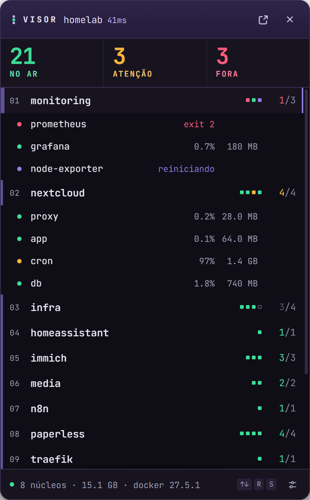
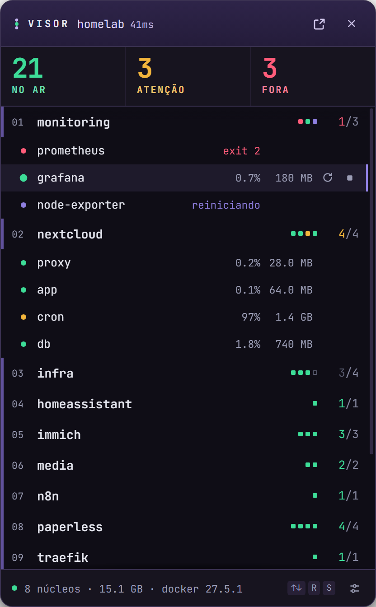
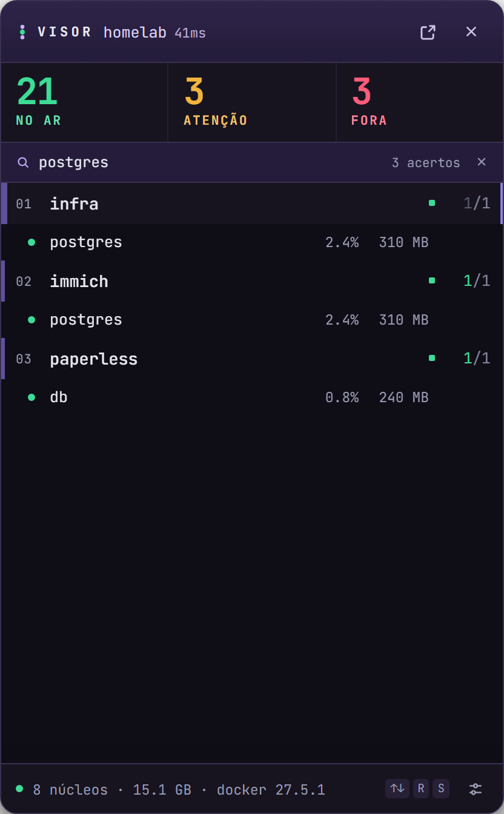
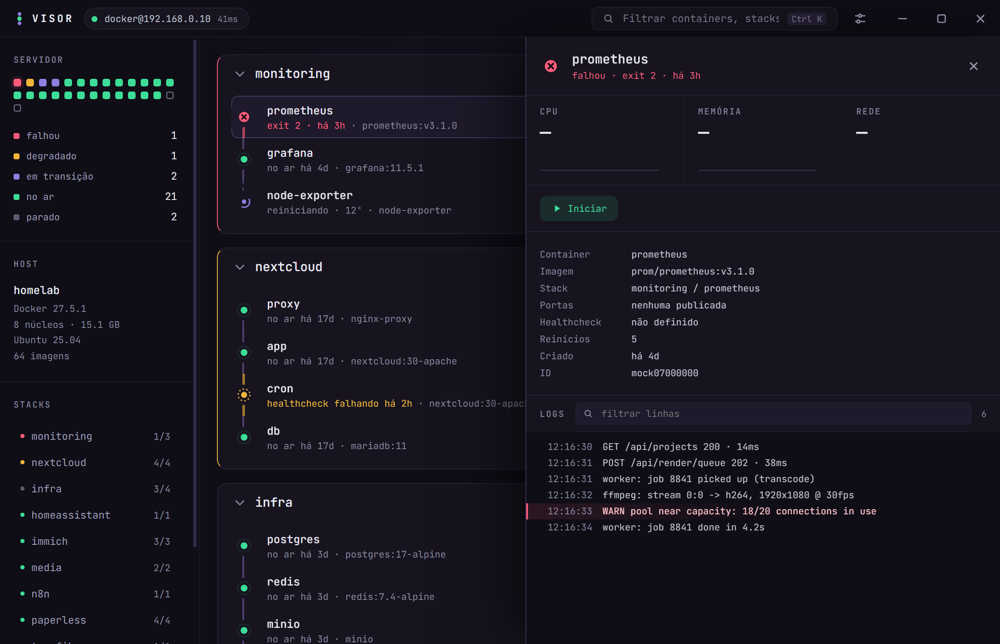
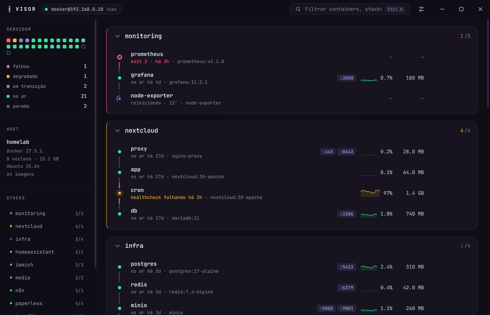
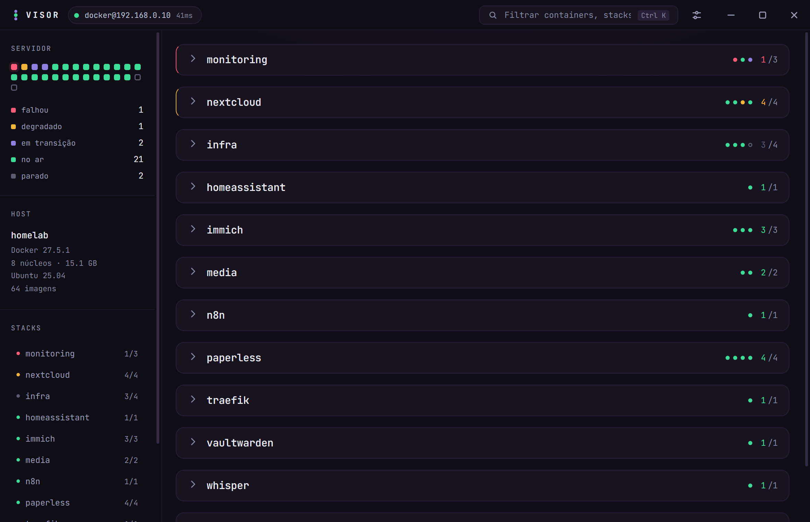

<div align="center">


# Visor

**Your remote Docker containers, one click from the Windows tray.**

No exposed port. No TLS certificates. No agent on the server.
Just the SSH key you already have.

[](LICENSE)
[](#install)
[](https://electronjs.org)
[](tsconfig.node.json)

<br />



</div>

<br />

## Why this exists

I kept opening a browser, logging into Portainer, and scrolling a list — just to
find out whether Jellyfin was still up. Fifteen times a day.

Portainer does far more than I needed. I wanted to glance and close. Two seconds.

So Visor lives in the tray. Left click, the panel opens anchored right there,
you see everything, it closes. The big window only exists when you actually need
logs or a chart.

## What it does

|  | |
|---|---|
| **Groups by Compose stack** | Reads `com.docker.compose.project`, because that's how you think about your services. Not a flat list of 25 containers. |
| **Restart from the panel** | Inline actions on every row. The most common reason to open it shouldn't send you somewhere else. |
| **Full keyboard** | Arrows to move, `R` to restart, `S` to stop. Start typing to filter — there's no room for a permanent search field in 416px. |
| **Native notifications** | When something dies, goes unhealthy, or enters a restart loop. Nothing else. |
| **Live logs and stats** | In the bigger window: streaming logs with `stderr` marked, CPU and memory sparklines. |
| **Runs in the background** | Starts with Windows, straight to the tray. The icon changes color with your server's health. |

## Install

Grab the installer from [Releases](../../releases), or build it yourself:

```bash
npm install
npm run dev     # development
npm run dist    # Windows installer
```

On first launch Visor asks which server to use. If it's already in your
`~/.ssh/config`, it shows up as a one-click chip with host, port, user and key
path filled in.

**What the server needs:** Docker running, and your SSH user in the `docker`
group. That's it.

```bash
groups | grep docker || sudo usermod -aG docker $USER
```

## How it talks to Docker

This is the part worth stealing for your own project.

```mermaid
flowchart TB
    A["🖥️ Visor on Windows"] -->|ssh2, key auth| B["🔐 SSH connection"]
    B -->|direct-streamlocal@openssh.com| C["🐳 /var/run/docker.sock"]
    A -->|dockerode| D["127.0.0.1:random"]
    D -.->|piped through the tunnel| B
    C --> E["/events · /stats · /logs · /containers"]
    E -.->|full Engine API| A
```

Instead of parsing `docker ps` over SSH, Visor forwards the **Unix socket**
itself using OpenSSH's `direct-streamlocal` extension, then points
[dockerode](https://github.com/apocas/dockerode) at a local port piped into it.

That gets you the entire Docker Engine API. Which means `/events` streaming, so
the UI reacts the moment a container changes instead of polling and hoping.

It also means:

- **Nothing is exposed.** No port 2375, no TLS certs to generate and rotate.
- **Nothing is installed server-side.** If you can `ssh` in, you're done.
- **Your key never leaves your machine.** Same key, same agent, same trust model.

The tunnel reconnects on its own with exponential backoff (1s → 30s) and
translates raw SSH errors into something actionable. A configuration error
doesn't retry — it stops and waits for you.

## Reading the panel

Every container is a node. **Shape carries the state, not just color** — so it
reads the same whether or not you distinguish green from amber.

| Node | State | Meaning |
|:---:|---|---|
| ● breathing ring | **up** | Running, healthcheck passing (or absent) |
| ● dashed ring | **degraded** | Running, but healthcheck failing — or paused |
| ◌ spinning arc | **transitioning** | Starting, restarting, or just created |
| ○ hollow | **stopped** | Exited cleanly (includes Compose init containers) |
| ✕ | **failed** | Exited with an error, or dead |

A colored spine runs down the left of each group. It stays neutral when
everything's fine and takes the color of the problem **exactly where it is**, so
you spot the break by shape before reading a word.

<div align="center">


</div>

### Keyboard

| Key | Action |
|---|---|
| `↑` `↓` | Move through the list |
| `→` `←` | Expand / collapse the group |
| `Enter` | Toggle group, or open container detail |
| `R` | Restart the container under the cursor |
| `S` | Stop, or start if it's already stopped |
| `a-z` `0-9` | Start filtering |
| `Esc` | Clear the search; if there's none, close |
| `Ctrl+Shift+D` | Open the panel from anywhere |

## The full window

Opens on demand, for when glancing isn't enough.

<div align="center">

</div>

Live logs with `stderr` given a left rail and a warm tone instead of shouting
red, a full technical sheet, and CPU/memory/network sparklines. Search covers
name, service, stack and image.

<details>
<summary><b>More screenshots</b></summary>
<br />

<p><em>The rail turns red at the failure and amber at the degraded service.</em></p>

<p><em>Everything collapsed: the whole server as an index, health in miniature.</em></p>
</details>

## How it compares

Visor is not trying to replace these. It does one thing they don't.

| | Visor | Portainer | Dockge | Lazydocker |
|---|:---:|:---:|:---:|:---:|
| Lives in the system tray | ✅ | — | — | — |
| Connects over plain SSH | ✅ | — | — | ✅ |
| Needs nothing on the server | ✅ | — | — | — |
| Native desktop notifications | ✅ | — | — | — |
| Edit stacks / compose files | — | ✅ | ✅ | — |
| Manage images, volumes, networks | — | ✅ | — | ✅ |
| Multiple hosts | — | ✅ | — | — |
| Runs in a terminal | — | — | — | ✅ |

If you need to **manage** infrastructure, use Portainer. Visor is for **watching**
it without breaking what you were doing.

## Honest limitations

- **Windows only.** Electron is cross-platform; what's missing is menu-bar
  anchoring for macOS and tray behavior for Linux desktops. PRs welcome.
- **The installer isn't signed.** SmartScreen will warn on first run.
  "More info" → "Run anyway".
- **One host at a time.** No multi-server switching yet.
- **Tested against exactly one server.** Mine. 25 containers, 11 stacks.
  If you run it against a Swarm or 100 containers, I'd like to know what broke.
- **Read-mostly.** Start, stop, restart and pause. No creating or editing stacks.

## Design

The direction is *rack instrument*: dense, catalogued, quiet. Saturated color
appears only when it carries state meaning, never as decoration.

The full design system — palette, type scale, components, wireframes, motion
specs — is in **[`ui-kit/Visor-UI-Kit.pdf`](ui-kit/Visor-UI-Kit.pdf)** (13 pages).
It's generated from `ui-kit/ui-kit.html`, which reuses the app's own tokens: the
components in it are rendered, not screenshotted.

Contrast is verified against the **running app**, not a preview — checking a dev
server is how you ship an unreadable build:

```bash
npm run dev
node scripts/check-contrast.mjs popover   # worst case currently 6.82:1
```

## Architecture

```
src/
├── shared/types.ts     Single contract across all three processes
├── main/
│   ├── tunnel.ts       SSH → direct-streamlocal → local TCP endpoint
│   ├── docker.ts       dockerode: list, stats, logs, /events, grouping
│   ├── popover.ts      Tray panel: anchoring, focus, exit animation
│   ├── watcher.ts      Diffs snapshots, decides what deserves interrupting
│   ├── sshConfig.ts    Reads ~/.ssh/config to suggest servers
│   └── index.ts        Window, tray, IPC, update loops
├── preload/index.ts    Typed contextBridge — the renderer never sees ipcRenderer
└── renderer/           React 19, no UI framework
```

<details>
<summary><b>Two Windows traps worth knowing about</b></summary>
<br />

Both cost more time than the rest of the panel combined:

**1. blur → hide race.** Clicking a tray icon doesn't move focus to your window.
So `blur` fires right after `show`, and the panel flickers shut before you see
it. Fixed with a 420ms grace window after showing.

**2. The toggle that never closes.** Clicking the icon while the panel is open
fires `blur` (hides it) and then `click` (which would show it again). A naive
toggle therefore never closes. Fixed by remembering when the last hide happened.

</details>

## Development

```bash
npm run dev      # app in development mode
npm run build    # typecheck + bundle
npm run icons    # regenerate tray/app PNGs (hand-written encoder, zero deps)

# Verify the SSH → Docker path outside Electron, read-only
VISOR_HOST=192.168.0.10 VISOR_USER=docker node scripts/probe.mjs

# Work on the UI in a browser, with realistic fake data
npx vite --config vite.preview.config.ts
#   ?mode=popover | ?mode=panel
#   &view=inspector | search | settings | collapsed
```

## License

MIT. This is a personal project published as-is. Use it, fork it, ship it.
There's no promise of support or of accepting feature requests — but bug
reports from setups unlike mine are genuinely useful.

<div align="center">
<br />
<sub>Built with Electron, TypeScript and React · <a href="docs/README.pt-BR.md">Leia em português</a></sub>
</div>
